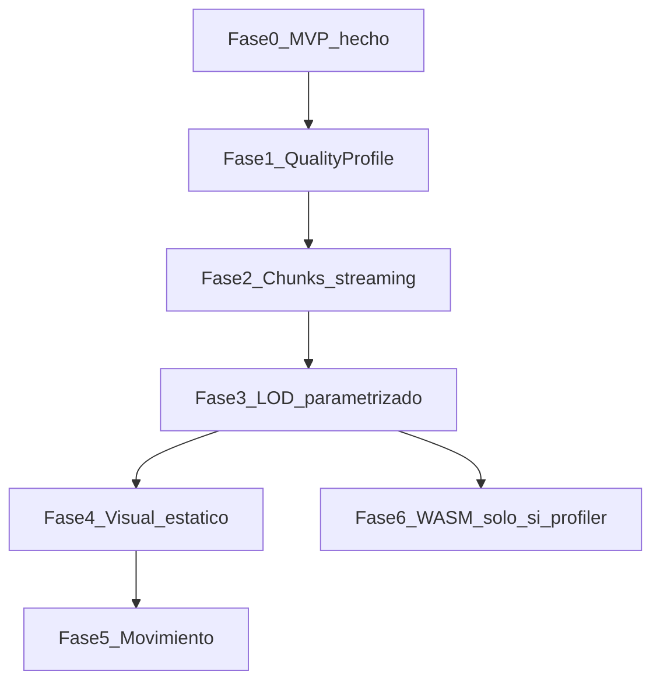

# Roadmap — Codarch City

**Última actualización:** 2026-10-24  
**Principio:** ciudad **estática** y legible primero; movimiento después. Rendimiento (LOD, chunks, presets de calidad) es eje, no remate. TS + Three.js hasta que el profiler diga lo contrario.

## Visión

Una simulación 3D del repo: no un treemap con metáfora de ciudad (CodeCharta / mapa Codarch), sino un **espacio urbano** donde la jerarquía del código se lee caminando/orbitando la ciudad. Visualmente bien poco a poco; realismo fotorrealista no es el objetivo cercano.

## Homologías (resumen)

| Código | Ciudad |
|---|---|
| Repo / proyecto | Ciudad |
| Carpetas top-level | Barrios |
| Subcarpetas | Urbanizaciones / manzanas |
| Ficheros / módulos | Edificios |
| Métricas (RLOC, complejidad) | Huella y altura |
| Riesgo | Color / deterioro |
| Dependencias | Calles / tráfico *(fases futuras)* |
| Símbolos | Habitantes / locales *(fases futuras)* |

Detalle: [homologias.md](./homologias.md).

## Estado de fases

| Fase | Nombre | Estado | Doc |
|---|---|---|---|
| 0 | MVP ciudad estática + GPU | **listo para revisión** | [fases/00-mvp.md](./fases/00-mvp.md) |
| 1 | QualityProfile + HUD de límites | **pendiente** | [fases/01-quality-profile.md](./fases/01-quality-profile.md) |
| 2 | Chunks espaciales + streaming por cámara | **pendiente** | [fases/02-chunks-streaming.md](./fases/02-chunks-streaming.md) |
| 3 | LOD / distancia de render parametrizable | **pendiente** | [fases/03-lod-distancia.md](./fases/03-lod-distancia.md) |
| 4 | Pulido visual estático | **pendiente** | [fases/04-visual-estatico.md](./fases/04-visual-estatico.md) |
| 5 | Ciudad viva (movimiento) | **aplazado** | [fases/05-ciudad-viva.md](./fases/05-ciudad-viva.md) |
| 6 | Aceleración nativa / WASM (si hace falta) | **aplazado** | [fases/06-nativo-wasm.md](./fases/06-nativo-wasm.md) |

## Orden de trabajo acordado

1. **Fase 1** — presets Bajo/Medio/Alto/Ultra y métricas de límite en el HUD.  
2. **Fase 2** — no cargar/dibujar toda la ciudad: celdas + lo visible (+ margen).  
3. **Fase 3** — el usuario (o el preset) elige distancias de detalle.  
4. **Fase 4** — que se vea bien sin animación.  
5. **Fase 5** — coches, habitantes, etc.  
6. **Fase 6** — Rust/WASM solo con evidencia de cuello de botella.

## Hecho hoy (base)

- App Electron + React + Three.js WebGL2 (ANGLE → D3D11).
- Forzado GPU discreta; HUD F3 (GPU, FPS, draws).
- `@codarch-city/city-model`: snapshot → barrios/edificios.
- Render con `InstancedMesh`; LOD lejano básico; inspector por clic.
- Puente: carpeta (CLI Codarch) / `cc.json` / demo sample.

## Fuera de alcance cercano

- WebGPU como renderer por defecto.
- CUDA / RT cores / DLSS.
- Motor Unreal/Godot.
- Reimplementar el análisis Codarch (se consume el CLI / `cc.json`).

## Cómo actualizar este doc

Al cerrar una fase: cambia su fila a **hecho**, pon fecha en el archivo de fase, y anota en “Notas de avance” abajo si hubo desviaciones.

### Notas de avance

- **2026-10-24** — Fase 0 implementada; docs + roadmap. Pendiente revisión de usuario.
- **2026-10-24** — Fix `npm run dev` si el puerto 5175 está ocupado (`strictPort: false`).
